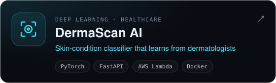
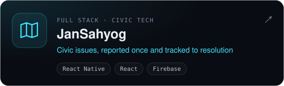
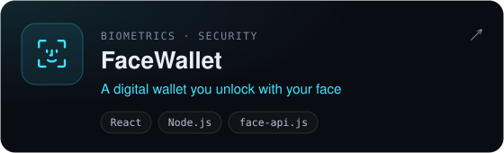
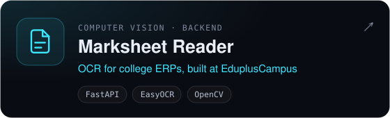
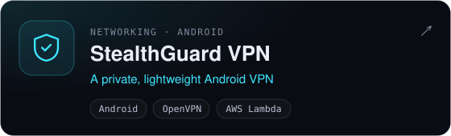
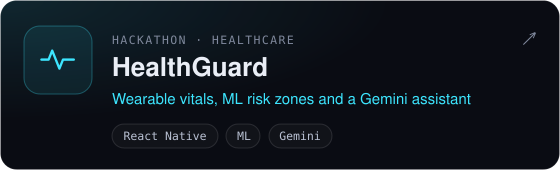
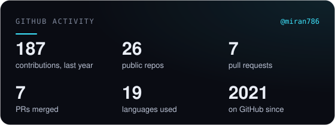
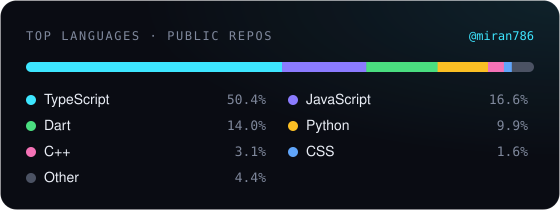

  

  
  
  
  

  

## Hey, I'm Miran 👋

I build machine learning systems and the software around them, and I make sure they still work after release.

- 🎓 **Final-year B.Tech CSE (AI)** at Vishwakarma Institute of Technology, Pune · **CGPA 9.24**. Before that: diploma in Computer Engineering, institute topper all three years, Best Outgoing Student and Student of the Year.
- 💼 **Software Developer Intern @ IDeaS (a SAS company)**: migrating a hotel revenue-management system's regression suite from Jenkins to GitHub Actions, and proving every property's output matches.
- 🧾 **Previously @ EduplusCampus**: an OCR marks-extraction pipeline (AWS Textract, S3, Lambda) for a college ERP.
- 🔬 **2 IEEE papers and 1 published Indian patent** on AI-based CCTV anomaly detection.
- 🛡️ **Open source**: [3 merged PRs to OWASP Nest](https://github.com/OWASP/Nest/pulls?q=is%3Apr+author%3Amiran786).
- 🎯 **Open to 2027 new-grad SDE and AI/ML roles**, in India or abroad.

## 🔬 Research & patent

| | Work | Venue |
|:-:|---|---|
| 📜 | **AI-Based Anomaly Detection in CCTV Surveillance** Indian Patent Application No. 202521049739 · filed May 2025 · published Jun 2025 · co-inventor | Indian Patent Office |
| 📄 | [**Unsupervised VAE-based Lesion Localization with EfficientNet Fusion for Dermatological Image Classification**](https://ieeexplore.ieee.org/document/11580784) The research behind DermaScan AI · DOI 10.1109/ICICI68773.2026.11580784 | IEEE ICICI 2026 |
| 📄 | [**Smart Pill Box Automation using IoT**](https://ieeexplore.ieee.org/document/11459556) ESP8266 pill dispenser with reminders and Firebase caregiver sync · DOI 10.1109/ICOSEC67334.2025.11459556 | IEEE ICOSEC 2025 |
| 🕒 | **CourtMind: AI Legal Courtroom Simulation** Deterministic legal reasoning with a sandboxed LLM and a multi-agent courtroom · under review | IEEE PuneCon 2026 |

## 🚀 Featured projects

<table>
  <tr>
    <td width="50%"></td>
    <td width="50%"></td>
  </tr>
  <tr>
    <td width="50%"></td>
    <td width="50%"></td>
  </tr>
  <tr>
    <td width="50%"></td>
    <td width="50%"></td>
  </tr>
</table>

<a href="https://miran-jamadar.vercel.app/#projects">See every project on my portfolio →</a>

## 🧰 Tech stack

   
   
  

## 📊 GitHub at a glance

  
  

  

  <picture>
    <source media="(prefers-color-scheme: dark)" srcset="https://raw.githubusercontent.com/miran786/miran786/output/snake.svg" />
    <source media="(prefers-color-scheme: light)" srcset="https://raw.githubusercontent.com/miran786/miran786/output/snake-light.svg" />
    
  </picture>

## 🏆 Recognition

**3rd Runner Up**, Aarohhan Hackathon 2026 · **Top 10**, Fusion 2025 (national) · **Finalist (solo)**, Google Developer Code Hackathon · **IBM** Full Stack Software Developer Professional Certificate

---

  <b>Let's build something that works.</b> 
  <a href="https://miran-jamadar.vercel.app">Portfolio</a> · <a href="https://www.linkedin.com/in/miran-jamadar">LinkedIn</a> · <a href="mailto:miran786mj@gmail.com">miran786mj@gmail.com</a>

<!-- Banner and project cards: scripts/make_art.py · Stats, languages and snake: refreshed daily by .github/workflows/profile.yml -->
